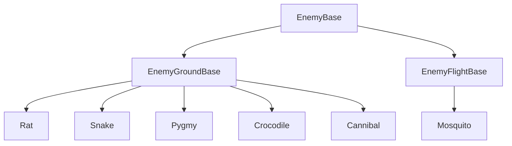

# 🏝️ Island Evolution – Demo

**Solo-developed 2D action-platformer built with Godot 4.8 and GDScript.**

Island Evolution is both a playable PC/Android demo and a technical portfolio project focused on:

- Modular gameplay architecture
- Reusable enemy systems
- Persistent progression and save systems
- Difficulty-driven gameplay evolution
- Android performance optimization
- Custom 2D animation and visual effects

🎮 **Platform:** PC / Android  
🛠️ **Engine:** Godot 4.8  
💻 **Language:** GDScript  
👤 **Development:** Solo project  
📱 **Current target:** Google Play Demo

> Core concept: the same jungle evolves across three difficulty levels —
> **Explorer → Survivor → King of the Island**.
>
> Enemies, environment, combat and Moko's abilities evolve with it.

---

# 🎬 Gameplay

[](https://youtu.be/xK7tqyqGYgM)


---

# 🎯 Demo Concept

Island Evolution is not based on simply increasing enemy health or damage.

The world itself evolves between difficulty levels.

The demo progressively transforms:

- 🌴 Environment and atmosphere
- 🐍 Enemy compositions and abilities
- 🔥 Visual effects
- 🎵 Audio atmosphere
- 🐵 Moko's abilities
- ⚔️ Combat possibilities
- 🏆 Overall challenge

The objective is to make each new difficulty feel like an evolution of the same island rather than a simple replay.

---

# 🐵 Moko

Moko is the protagonist of Island Evolution.

His movement and combat systems include:

- Running
- Jumping
- Climbing
- Hanging
- Wall interactions
- Melee attacks
- Projectile attacks
- Healing
- Collectibles
- Unlockable abilities

Moko progressively becomes stronger as the player completes the demo.

---

# 🎮 Demo Progression

## 🌿 Explorer

The first version of the island.

The jungle is alive, bright and relatively peaceful.

The player discovers:

- Movement
- Combat
- Exploration
- Collectibles
- Enemies
- The level objective

Completing Explorer unlocks:

**Double Jump**

and opens the next difficulty:

**Survivor**

---

## 🌅 Survivor

The island begins to change.

The atmosphere becomes darker and more dangerous.

Changes include:

- New enemy configurations
- More dangerous encounters
- Environmental smoke
- Evolving jungle atmosphere
- Double Jump available
- New optional areas accessible through Double Jump

Completing Survivor unlocks:

**Fire Power**

and opens:

**King of the Island**

---

## 🔥 King of the Island

The island reaches its most hostile form.

The jungle is transformed by fire and destruction.

Changes include:

- Burned vegetation
- Fire effects
- Smoke
- Darker atmosphere
- Stronger enemy combinations
- Enemy healer variants
- Fire-enhanced combat
- Increased combat pressure

This represents the final challenge of the demo.

---

# 🌴 Tropical Jungle

The demo currently contains one complete playable level:

## Level 1 — Tropical Jungle

The player must explore the jungle and complete the following objective:

**5 Seeds → Activate the Totem → Obtain the Key → Reach the Exit**

The level structure remains recognizable across all three difficulties, while its gameplay, enemies and atmosphere evolve.

---

# ⚔️ Combat

Moko can fight using melee attacks and projectile weapons.

## Melee Attacks

- Clac
- Kick
- Headbutt

## Projectile Weapons

- Coconut
- Bone
- Spear

Projectile attacks can also evolve through the Fire ability.

---

# 👾 Enemies

The demo contains several enemy types built around reusable gameplay behaviors.

Examples include:

- Mosquito
- Rat
- Snake variants
- Pygmy
- Crocodile
- Cannibal

Enemy placement, roles and combinations evolve depending on the selected difficulty.

---

# 🐍 Evolving Enemy Composition

Enemy evolution is not limited to increasing health or damage.

The composition of encounters can change between difficulty levels.

One example is a group of snakes encountered in the jungle.

### Explorer

- 3 Melee Snakes

### Survivor

- 2 Ranged Snakes
- 1 Melee Snake

### King of the Island

- 1 Ranged Snake
- 1 Melee Snake
- 1 Healer Snake

The same encounter therefore evolves from a straightforward melee confrontation into a group with complementary combat roles.

This changes the tactical structure of the encounter without changing the basic level layout.

---

# ❤️ Snake Healer

The King difficulty introduces a healer variant.

The healer can:

- Detect injured allies
- Select a healing target
- Launch a healing projectile
- Restore enemy health
- Use dedicated healing animations and visual effects

This introduces target prioritization into combat and forces the player to adapt their strategy.

---

# 🧩 Architecture

Island Evolution uses a modular gameplay architecture.

The objective is to keep gameplay systems reusable, maintainable and separated by responsibility while avoiding unnecessary duplication between entities.

---

# 🧱 Player Architecture

The Player acts as an orchestrator for specialized gameplay modules.

```text
GameState
   │
   ├── Player
   │     ├── Movement
   │     ├── Combat
   │     ├── Skills
   │     ├── Items
   │     ├── Damage
   │     ├── Effects
   │     └── HUD synchronization
   │
   ├── HUD
   │
   └── Enemies
```

Gameplay responsibilities are separated instead of being concentrated inside a single player script.

This makes individual systems easier to maintain and evolve independently.

---

# 👾 Enemy Architecture

Enemies share common base classes and reusable modules.



Reusable enemy capabilities include systems such as:

- Target detection
- Melee attacks
- Ranged attacks
- Healing
- Patrol
- Movement behaviors

This keeps individual enemy scripts focused primarily on configuration and enemy-specific behavior.

---

# 🌍 GameState

A global GameState manages the main persistent systems of the demo.

Responsibilities include:

- Current difficulty
- Difficulty unlocks
- Skill progression
- Level progression
- Save/load state
- Player respawn
- Persistent collectibles
- Persistent defeated enemies
- Level transitions

This provides a centralized source of truth for progression while gameplay logic remains distributed across specialized systems.

---

# 💾 Persistent Progression

Progression is stored between runs.

The demo tracks information such as:

- Current difficulty
- Explorer completion
- Survivor completion
- King completion
- Unlocked abilities
- Current level progression
- Persistent gameplay state

The main menu also evolves visually according to the player's progression.

---

# 🎨 Evolving Environment

The environment itself reflects progression.

## 🌿 Explorer

- Bright jungle
- Normal vegetation
- Clear atmosphere

## 🌅 Survivor

- Sunset / darker atmosphere
- Smoke
- Environmental degradation

## 🔥 King of the Island

- Dark environment
- Fire
- Smoke
- Burned vegetation
- More aggressive visual atmosphere

The main menu follows the same evolution and reflects the highest difficulty reached by the player.

---

# 🔥 Visual Effects

The demo includes visual effects for:

- Fire
- Smoke
- Embers
- Healing
- Fire-powered attacks
- Difficulty-specific atmosphere

These effects are currently being reviewed and optimized as part of the Android performance pass.

---

# 📱 Android Optimization

The demo is currently being optimized and tested for Android.

Optimization work includes:

- Reducing oversized sprite sheets
- Splitting large animation atlases
- Removing unused demo resources
- Reducing particle counts
- Optimizing smoke and fire effects
- Reducing unnecessary memory usage
- Cleaning unused scenes, scripts and assets
- Testing the game on physical Android hardware

The objective is to maintain the visual identity of the PC version while reducing memory and rendering costs enough for reliable execution on modest Android hardware.

Android optimization is an active part of the current development process.

---

# 🎨 Art Pipeline

Game assets are created and edited specifically for Island Evolution.

Main tools:

- **Clip Studio Paint** — characters, sprite sheets and animations
- **Adobe Photoshop** — textures, UI and image editing
- **Godot Engine** — integration, animation, effects and gameplay

Visual direction:

**Stylized cartoon tropical adventure**

---

# 🛠️ Technology

- **Engine:** Godot 4.8
- **Language:** GDScript
- **Version Control:** Git / GitHub
- **Target Platforms:** PC / Android
- **Mobile Pipeline:** Android export and physical-device testing
- **2D Art:** Clip Studio Paint / Adobe Photoshop

---

# 🔧 Installation

## Requirements

**Godot Engine 4.8**

Clone the repository:

```bash
git clone https://github.com/Steph4477/IslandEvolution-Demo.git
cd IslandEvolution-Demo
```

Open:

```text
project.godot
```

with Godot Engine 4.8.

---

# 🚀 Demo Roadmap

Current priorities:

- Android optimization
- Android physical-device testing
- Final visual polish
- Audio evolution between difficulties
- Loading screen polish
- Difficulty-specific skill evolution
- Final balancing
- Final teaser
- Google Play demo release

---

# 👤 Developer

**Stéphane Morel**

Solo Game Developer  
Godot / GDScript

**Island Evolution**

---

# 📄 License

This repository is public for portfolio and educational purposes.

You may study the source code and architecture for personal learning.

You may NOT, without explicit permission from the author:

- Reuse game assets
- Reuse characters
- Reuse the Island Evolution visual identity
- Redistribute the game or its assets
- Commercialize the project or its content

All original game assets and characters remain the property of their respective author.
